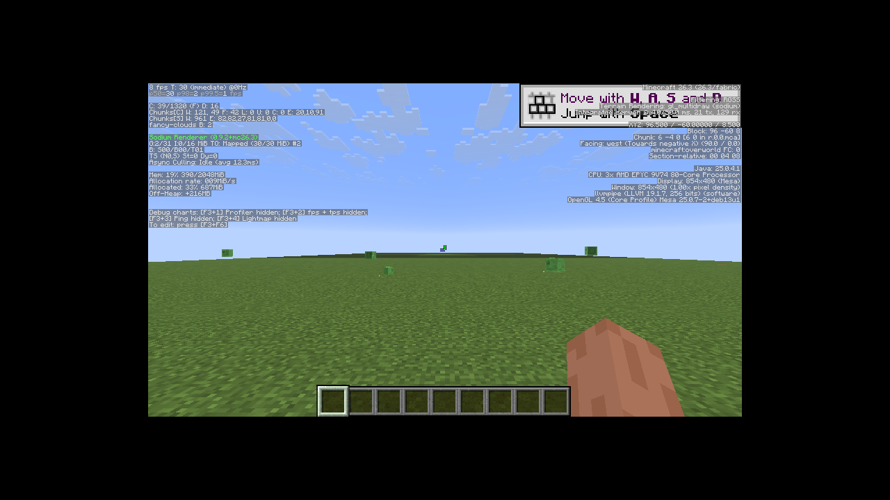

# 🧱 Bobby · Minecraft 26.3

[](https://github.com/snowtravit/bobby-26.3/releases/latest)
[](https://fabricmc.net/use/installer/)
[](https://adoptium.net/)
[](LICENSE.LESSER.md)

Bobby keeps previously visited chunks visible beyond a server's view distance.
It saves chunks sent by the server in `.minecraft/.bobby` and loads them again
when they leave the server's view distance.

This is **snowtravit's fork** of [Johni0702/Bobby](https://github.com/Johni0702/bobby).
The Minecraft 26.3 implementation follows upstream
[v5.2.16+mc26.3](https://github.com/Johni0702/bobby/releases/tag/v5.2.16%2Bmc26.3).
The original mod, its history, and its contributors remain credited to upstream.

**[⬇️ Download the fork release](https://github.com/snowtravit/bobby-26.3/releases/latest)**
· [📋 Upstream changelog](CHANGELOG.md)
· [🐛 Report a fork issue](https://github.com/snowtravit/bobby-26.3/issues)

## 🎮 Install

1. Use **Minecraft 26.3**, **Java 25**, and the
   [Fabric Loader](https://fabricmc.net/use/installer/). Loader **0.19.5** was used
   for the packaged JAR runtime check; the source builds against **0.19.3**.
2. Download `bobby-5.2.16+mc26.3.jar` from this fork's release page.
3. Put the JAR in your Minecraft instance's `mods` folder and start the Fabric client.
4. Visit chunks before moving away: Bobby can then display their saved contents.

Bobby is a **client mod**. Cached chunks are a saved view of the world; blocks in
those chunks can be out of date until the server sends them again.

Optional additions:

| Mod | Purpose | Version targeted by this source |
| --- | --- | --- |
| [Sodium](https://modrinth.com/mod/sodium) | Alternative renderer | 0.9.2 for Minecraft 26.3 |
| [Mod Menu](https://modrinth.com/mod/modmenu) | Open the in-game configuration screen | 21.0.0-beta.1 |
| [Cloth Config](https://modrinth.com/mod/cloth-config) | Configuration screen support | 26.3.158 |

Install Mod Menu and Cloth Config together to edit settings in game. Bobby also
reloads its configuration when the config file changes.

## 📸 Checked in Minecraft



The packaged release JAR was loaded from `mods` in a local Creative/Superflat
world. With the integrated server's view distance set to **2**, travelling,
saving, and reopening the world left **42 cached chunks** loaded by Bobby
(`F:42` on the debug screen). The same scenarios were checked with the standard
renderer and with **Sodium 0.9.2**.

The runtime check used software rendering in an offline local world. External
multiplayer servers and GPU performance were not measured.

## 🗺️ Use a fallback world

Bobby can also read chunks from an existing single-player world that the server
has never sent. Rename that world's **folder** in `.minecraft/saves` to
`bobby-fallback`. This is the folder name, not the world's display name.

## 🛠️ Build from source

Install **JDK 25**, clone this repository, and run the included Gradle wrapper:

```sh
./gradlew build
```

On Windows:

```powershell
.\gradlew.bat build
```

The resulting JAR is written to `build/libs/`. This source targets Minecraft
26.3; other Minecraft versions require their matching source and dependencies.
For IDE setup, see the [Fabric development guide](https://docs.fabricmc.net/develop/getting-started/setting-up-a-development-environment).

## 📜 License and credits

Bobby is licensed under **GNU LGPL version 3 or, at your option, any later
version** (`LGPL-3.0-or-later`). [LICENSE.LESSER.md](LICENSE.LESSER.md) contains
the LGPL terms, which incorporate the GPL version 3 text in
[LICENSE.md](LICENSE.md). Both original license files are retained.

The mod was created by **Johni0702** and the
[upstream contributors](https://github.com/Johni0702/bobby/graphs/contributors).
This fork preserves their credit and license. Fork downloads are hosted on
[snowtravit/bobby-26.3](https://github.com/snowtravit/bobby-26.3/releases);
the upstream project also publishes on [Modrinth](https://modrinth.com/mod/bobby)
and [CurseForge](https://www.curseforge.com/minecraft/mc-mods/bobby).
